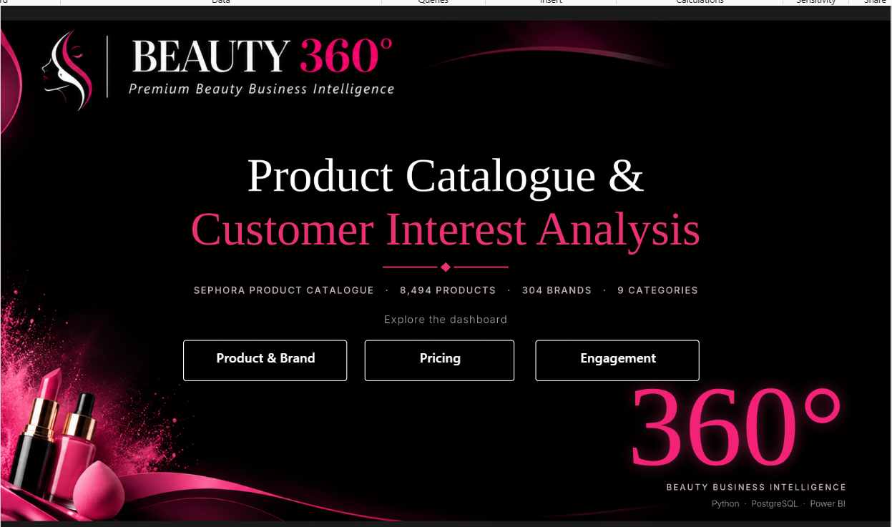

 # 💄 BEAUTY 360° — Beauty E-commerce Analytics

**From raw product data to business decisions using Python, PostgreSQL and Power BI.**


---

## 📌 1. Project Overview

**BEAUTY 360°** is an end-to-end business analytics project built around the beauty and cosmetics e-commerce industry.

Using a Sephora product catalogue dataset, I analysed product assortment, brand performance, pricing, product availability and customer engagement to identify business opportunities and support merchandising decisions.

The project follows a complete analytics workflow, from raw data exploration and cleaning to SQL-based ETL and interactive Power BI reporting.

**The objective is not just to visualise data, but to translate analysis into meaningful business recommendations.**

## 🎯 2. Business Problem

Beauty e-commerce businesses manage thousands of products across brands, categories and price segments.

This creates important business questions:

- Which categories dominate the product assortment?
- Which brands attract stronger customer interest?
- How are products positioned across different price segments?
- Which categories have higher product unavailability?
- Does customer engagement differ between budget and premium products?
- What opportunities exist to improve assortment and merchandising?

**Goal:** Build a data-driven view of the product catalogue to support better business decisions.

## 📊 3. Project Highlights

| Metric | Result |
|---|---:|
| Products Analysed | 8,494 |
| Brands Covered | 304 |
| Product Categories | 9 |
| Average Product Rating | 4.19 / 5 |
| Total Customer Loves | 247.85M |
| Average Product Price | $51.66 |
| Out-of-Stock Products | 626 |
| Out-of-Stock Rate | 7.37% |

## 🛠 4. Technology Stack

| Technology | Application |
|---|---|
| Python | EDA, data cleaning and feature engineering |
| Pandas & NumPy | Data manipulation and transformation |
| Matplotlib & Seaborn | Exploratory visualisation |
| PostgreSQL | Data storage and ETL |
| SQL | Data transformation and validation |
| Power BI | Interactive dashboards |
| DAX | KPIs and analytical measures |
| Git & GitHub | Version control and documentation |

## 🔄 5. Project Architecture

```text
             RAW DATASET
                  |
                  ▼
           PYTHON / PANDAS
                  |
          Exploratory Analysis
                  |
             Data Cleaning
                  |
          Feature Engineering
                  |
                  ▼
           CLEANED DATASET
                  |
                  ▼
             POSTGRESQL
                  |
            Staging Table
                  |
              SQL ETL
                  |
           Reporting Table
                  |
                  ▼
              POWER BI
                  |
           DAX Measures & KPIs
                  |
          Interactive Dashboards
                  |
                  ▼
        BUSINESS INSIGHTS
         & RECOMMENDATIONS
```

## 🐍 6. Python — EDA & Data Preparation

Python was used to understand the dataset, identify data-quality issues and prepare it for reporting.

### Exploratory Data Analysis

- Dataset structure, dimensions and data types.
- Missing values and duplicate identification.
- Product, brand and category distribution.
- Price distribution and outlier examination.
- Ratings and customer-engagement analysis.
- Category-level and brand-level comparisons.

### Data Cleaning Decisions

| Data Issue | Decision |
|---|---|
| `variation_desc` — approximately 85% missing | Dropped |
| `variation_type` | Retained |
| `variation_value` | Retained |
| `size` | Retained |
| `ingredients` and `highlights` | Retained in cleaned source |
| Missing ratings | Preserved as missing |

The final cleaned reporting dataset contains **8,494 rows and 28 columns**.

### Feature Engineering

Created analytical features to support business comparisons:

- **Price Segments:** Budget, Mid-Range and Premium.
- **Engagement Segments:** Quartile-based customer-interest groups.
- **Rating Bands:** Highly Rated, Well Rated, Below 4.0 and Not Rated.

**Price segmentation rules:**

| Segment | Price Rule |
|---|---|
| Budget | ≤ $25 |
| Mid-Range | > $25 and ≤ $75 |
| Premium | > $75 |

## 🗄 7. PostgreSQL — ETL & Validation

PostgreSQL was used to structure the cleaned data and prepare a reporting-ready table.

### ETL Workflow

1. Created the `beauty360` database.
2. Loaded cleaned data into `stg_product_catalogue`.
3. Transformed and loaded records into `product_catalogue`.
4. Validated product identifiers and business metrics.

### SQL Validation Results

| Validation | Result |
|---|---:|
| Total Records | 8,494 |
| Distinct Product IDs | 8,494 |
| Distinct Brands | 304 |
| Distinct Categories | 9 |
| Average Rating | 4.19 |
| Total Customer Loves | 247,851,233 |
| Out-of-Stock Products | 626 |

Python and SQL outputs were cross-checked to improve reporting consistency.

## 📈 8. Power BI — Interactive Dashboard

The Power BI report contains one homepage and three analytical pages, designed using a consistent black, pink and white beauty-inspired theme.

### Homepage



### Page 1 — Product & Brand Performance


**Focus areas:**
- Product distribution by category.
- Top brands by average customer interest.
- Most-loved products.
- Out-of-stock rate by category.

**Business purpose:** Understand assortment concentration, brand engagement and availability patterns.

### Page 2 — Pricing & Product Positioning


**Focus areas:**
- Product distribution by price segment.
- Average price by category.
- Top expensive brands.
- Ratings across price segments.

**Business purpose:** Evaluate catalogue pricing structure and product positioning.

### Page 3 — Customer Engagement & Product Insights


**Focus areas:**
- Average loves per product by category.
- Brand engagement and ratings comparison.
- Customer engagement by price segment.
- Product rating distribution.

**Business purpose:** Identify customer-interest patterns and opportunities for further merchandising analysis.

## 🔍 9. Key Business Findings

### A. Findings from Power BI

| Finding | Result |
|---|---:|
| Largest category | Skincare — 2,420 products |
| Second-largest category | Makeup — 2,369 products |
| Budget average loves | 35.4K |
| Mid-Range average loves | 30.4K |
| Premium average loves | 15.0K |
| Budget average rating | 4.27 |
| Premium average rating | 4.09 |

**Key discovery:** Budget products receive approximately 2.4× the average customer loves of premium products.

### B. Additional Python Notebook Discoveries

These findings provide deeper analysis beyond the dashboard visuals.

**1. Category-level customer interest**

| Category | Average Loves per Product |
|---|---:|
| Makeup | 54.2K |
| Skincare | 27.1K |
| Mini Size | 26.7K |
| Bath & Body | 16.5K |
| Tools & Brushes | 15.0K |
| Hair | 13.7K |
| Fragrance | 12.8K |

**Insight:** Skincare has the largest assortment, but Makeup has the highest average customer loves per product. Catalogue size does not necessarily indicate customer interest.

**2. Catalogue pricing structure**

| Metric | Result |
|---|---:|
| Average Price | $51.66 |
| Median Price | $35.00 |
| Budget Share | 27.24% |
| Mid-Range Share | 56.02% |
| Premium Share | 16.74% |
| Premium Products | 1,422 |

**Insight:** The average price is higher than the median, indicating that relatively expensive products influence the overall average.

**3. Brand engagement analysis**

Top brands identified using average loves per product, with a minimum threshold of 20 products:

Rare Beauty, The Ordinary, Fenty Beauty, NARS, Urban Decay, Glow Recipe, LANEIGE, Anastasia Beverly Hills, Kosas and Sol de Janeiro.

**Insight:** Average engagement per product provides a more comparable brand-level indicator than total loves alone.

**4. Additional catalogue findings**

- Online-only products: **21.91%**
- Sephora-exclusive products: **27.94%**
- Total customer reviews: **Approximately 3.69M**

**Insight:** Exclusivity and online-only assortment provide additional dimensions for merchandising and catalogue analysis.

## 💡 10. Business Recommendations

| Observation | Recommended Action |
|---|---|
| Skincare and Makeup dominate assortment | Review category assortment balance |
| Budget products show stronger engagement | Investigate budget-range merchandising |
| Premium products show lower engagement | Review premium positioning and customer feedback |
| Products are marked out of stock | Investigate availability and replenishment processes |
| Some brands show stronger engagement | Explore brand-level merchandising opportunities |

**Overall business takeaway:** The analysis highlights opportunities to investigate assortment balance, price positioning, brand engagement and product availability.

## ⚠️ 11. Limitations & Assumptions

- The dataset represents a product catalogue snapshot.
- It does not contain actual sales or transaction records.
- Customer loves and reviews are engagement indicators, not sales.
- Revenue, profit and conversion cannot be calculated.
- Missing ratings are not treated as zero.
- Price thresholds and brand-ranking eligibility rules are analytical choices.

These limitations are important when interpreting the findings and making business recommendations.

## 📁 12. Repository Structure

```text
BEAUTY_360/
│
├── Assets/
├── Data/
│   ├── beauty_360_cleaned.xls
│   └── product_info.csv
│
├── Documentation/
│   └── Business_Requirements_Document.pdf
│
├── Python/
│   └── Product_Catalogue_Analysis.ipynb
│
├── PowerBI/
│   ├── Dashboard.pbix
│   ├── Dashboard.pbit
│   ├── Dashboard.pdf
│   └── README.md
│
├── SQL_ETL/
│   └── beauty360_etl.sql
│
├── Screenshots/
│
├── README.md
├── requirements.txt
└── LICENSE
```

## 🚀 13. How to Run

**Clone the repository:**

```bash
git clone https://github.com/seema-kri/beauty360.git
cd beauty360
```

**Install dependencies:**

```bash
pip install -r requirements.txt
```

**Run the project:**

1. Open and execute the Python notebook.
2. Configure PostgreSQL and execute the SQL ETL script.
3. Open `PowerBI/Dashboard.pbix` in Power BI Desktop.
4. Update the database connection if required.

## 🔮 14. Future Scope

- Integrate actual sales and transaction data.
- Build inventory and stockout monitoring.
- Perform customer review sentiment analysis.
- Develop product recommendation models.
- Introduce demand forecasting using historical sales data.

## 👩‍💻 15. Author

**Seema Kumari | Aspiring Data Analyst**

📧 [Email](mailto:seemakri136@gmail.com)  
💼 [LinkedIn](https://linkedin.com/in/seema-kumari-375763308)  
💻 [GitHub](https://github.com/seema-kri)

Open to data analyst roles, collaborations and conversations around analytics.

---

⭐ If you find this project useful, consider giving the repository a star!

**BEAUTY 360° — Built with Python, PostgreSQL and Power BI. Focused on data quality, business thinking and actionable decisions.**
